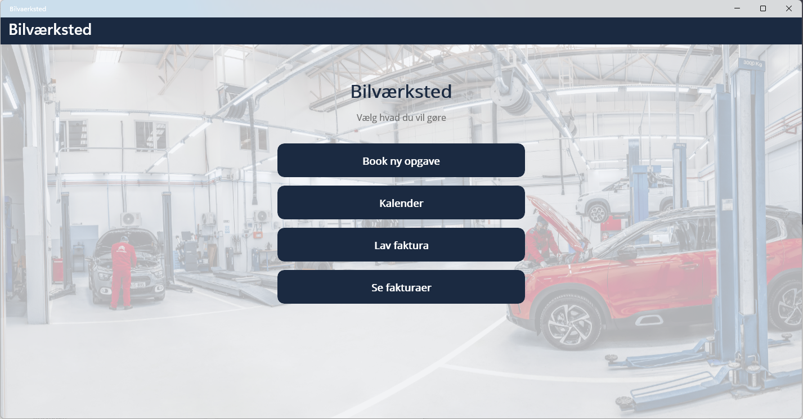

# Car Workshop App (Bilværksted)

A .NET MAUI desktop app for managing a car workshop. Staff can book jobs, see booked days in a calendar, and create and look up invoices.

## Features

- **Job booking:** Book repair and service jobs
- **Calendar overview:** See which days are booked
- **Invoicing:** Create invoices for completed jobs
- **Invoice history:** Find and view previous invoices

## Built with
- C# / .NET MAUI
- SQLite

## Getting started

**Requirements:** Windows, .NET 10 SDK, MAUI workload (`dotnet workload install maui`)

1. Open the project folder in VS Code.
2. Press **F5** and select **Local Machine**.

The database is empty on first launch. Start by booking a job to see it appear in the calendar.
